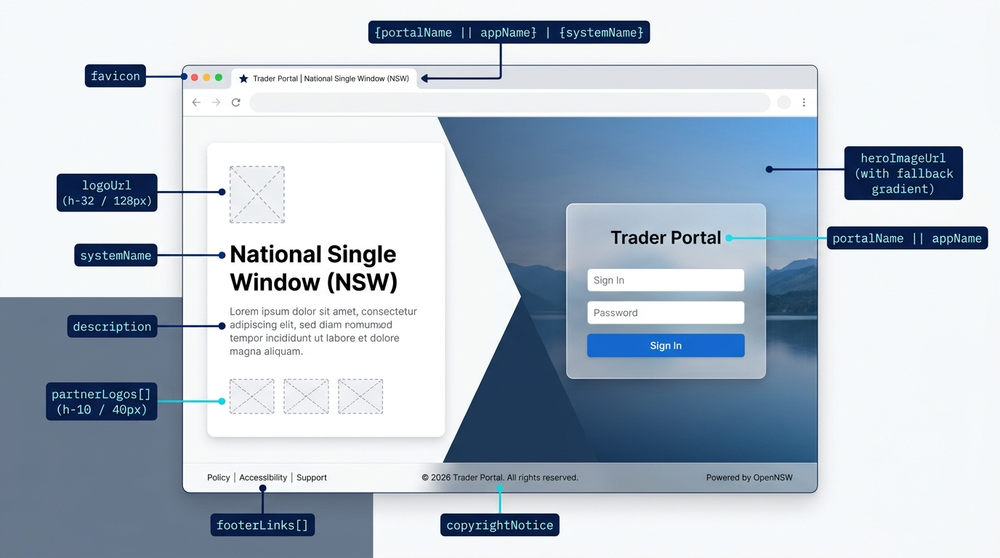
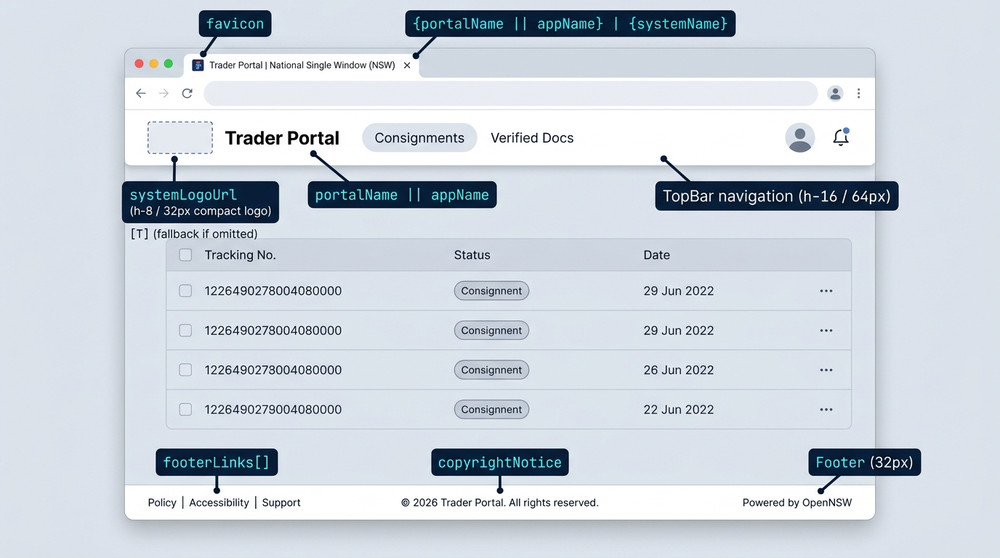
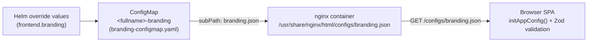

# Configuring portal logos and branding

This guide sets up the logos, titles, hero background and footer links for the **Trader Portal** (`APP_MODE: "tnsw"`) or an **Agency Officer Portal** (`APP_MODE: "agency"`) using the [`deployments/helm/lk-tnsw`](../../deployments/helm/lk-tnsw) Helm chart.

## Where each property appears

The portal reads all branding properties from `frontend.branding` in your Helm override file.

### Login screen (`/login`)



_Note: Clicking **Sign In** on the login screen redirects the user to the OIDC Identity Provider (ThunderID) to enter credentials; the portal card itself shows only the portal title, tagline and button._

### Signed-in portal (`TopBar` and `Footer`)



## How branding works



1. **Baked-in placeholder**: At build time, the `tnsw-web` image includes a neutral placeholder [`public/configs/branding.json`](../../portals/apps/trader-app/public/configs/branding.json).
2. **Helm ConfigMap mount**: When `frontend.branding` is non-empty in your Helm values, [`templates/frontend/branding-configmap.yaml`](../../deployments/helm/lk-tnsw/templates/frontend/branding-configmap.yaml) wraps your values inside `{ "branding": { ... } }` and mounts it over `/usr/share/nginx/html/configs/branding.json` via [`templates/frontend/deployment.yaml`](../../deployments/helm/lk-tnsw/templates/frontend/deployment.yaml).
3. **Startup validation**: At startup, [`initAppConfig()`](../../portals/apps/trader-app/src/config.ts) fetches `/configs/branding.json` and validates it against [`UIConfigSchema`](../../portals/apps/trader-app/src/configs/types.ts).

> [!CAUTION]
> If **any** field in `frontend.branding` fails schema validation — for example, a relative path in `footerLinks[].url` or an unsupported `footerLinks[].key` — the entire `branding.json` is rejected and the app falls back to `{ systemName: "NSW", appName: "Trader Portal" }` with no logos or footer links.

## Configuration reference (`frontend.branding`)

All fields are validated by [`UIConfigSchema`](../../portals/apps/trader-app/src/configs/types.ts):

| Key               | Type     | Required | UI location and sizing                                                                                           | Description                                                                                                                                           |
| ----------------- | -------- | -------- | ---------------------------------------------------------------------------------------------------------------- | ----------------------------------------------------------------------------------------------------------------------------------------------------- |
| `systemName`      | `string` | **Yes**  | Login left panel heading (`text-4xl`, `text-5xl` at `xl`), mobile login header, and browser tab title suffix.    | Non-empty string identifying the overarching system (for example `"NSW"` or `"DEA"`).                                                                 |
| `appName`         | `string` | **Yes**  | `alt` text on the login logo (`logoUrl`), and fallback for the display title when `portalName` is omitted.       | Non-empty string naming the application (for example `"Trader Portal"`).                                                                              |
| `portalName`      | `string` | No       | Login authentication card heading, TopBar title next to `systemLogoUrl`, and browser tab title prefix.           | Overrides `appName` as the visible portal title (`portalName \|\| appName`).                                                                          |
| `description`     | `string` | No       | Login screen left identity panel, below `systemName` (below `tagline` and a rule, when `tagline` is set).        | Short paragraph describing the portal's purpose, in muted body text. A newline starts a new paragraph.                                                |
| `tagline`         | `string` | No       | Login screen left identity panel, directly below `systemName` (`text-xl`, `text-2xl` at `xl`).                   | One-sentence lead under the heading. When set, a horizontal rule separates it from `description`.                                                     |
| `logoUrl`         | `string` | No       | **Login screen only**: Desktop left panel (`h-32` / `128px` height, `object-contain`) and mobile top strip.      | URL or mounted path to the primary organization logo. Hidden when empty or omitted.                                                                   |
| `systemLogoUrl`   | `string` | No       | **Signed-in TopBar only**: Top-left compact brand mark (`h-8` / `32px` height, `w-auto object-contain`).         | URL or mounted path to a compact emblem or icon. When omitted, renders a `36x36px` gradient badge with the first letter of `portalName \|\| appName`. |
| `favicon`         | `string` | No       | Browser tab icon (`<link rel="icon">`).                                                                          | URL or mounted path to an `.svg`, `.png` or `.ico` icon.                                                                                              |
| `heroImageUrl`    | `string` | No       | **Login screen only**: Right-hand background panel (`bg-cover bg-center`, diagonal clip on desktop).             | URL or mounted path to a high-resolution background image (`1920x1080` recommended). Falls back to the primary theme gradient when omitted.           |
| `partnerLogos`    | `array`  | No       | **Login screen only**: Row of partner/agency logos beneath `description` (`h-10` / `40px` height, `opacity-80`). | List of `{ url: string, alt: string }` objects. Entries with an empty `url` are skipped.                                                              |
| `footerLinks`     | `array`  | No       | **Global footer**: Left-aligned external links on every screen.                                                  | List of `{ key, url }` objects. Must follow the strict validation rules below.                                                                        |
| `copyrightNotice` | `string` | No       | **Global footer**: Centered text at the bottom of the viewport.                                                  | Free-text copyright notice (for example `"© 2026 Trader Portal. All rights reserved."`).                                                              |

### Rules for `footerLinks`

In [`types.ts`](../../portals/apps/trader-app/src/configs/types.ts) and [`Footer.tsx`](../../portals/apps/trader-app/src/components/Layout/Footer.tsx):

1. **`key` must be one of three exact values**: `policy`, `accessibility` or `support`. Labels are not configured in YAML; the portal translates the label from its i18n bundle (`"Policy"`, `"Accessibility"`, `"Support"`).
2. **`url` must be an absolute `http://` or `https://` URL**: Relative paths (such as `/policy`) fail schema validation.

## Supplying logo and image files

You can serve the images referenced by `logoUrl`, `systemLogoUrl`, `favicon`, `heroImageUrl` and `partnerLogos` in two ways:

### Option A: External HTTPS URLs

Host your logos and hero image on a public static host, CDN or object storage bucket, and set the URLs in `frontend.branding` to `https://...`. No extra Kubernetes volumes are needed.

### Option B: Mount image files into the frontend container via a ConfigMap

Because [`templates/frontend/deployment.yaml`](../../deployments/helm/lk-tnsw/templates/frontend/deployment.yaml) supports `frontend.volumes` and `frontend.volumeMounts`, you can package SVG/PNG/WebP assets into a Kubernetes ConfigMap and mount them at `/usr/share/nginx/html/branding-assets`.

#### Step 1: Create a ConfigMap from your asset files

Place your assets in a local directory (for example `./branding-assets/`) and create a ConfigMap in your deployment namespace:

```sh
kubectl -n <namespace> create configmap tnsw-branding-assets \
  --from-file=logo.svg=./branding-assets/logo.svg \
  --from-file=mark.svg=./branding-assets/mark.svg \
  --from-file=favicon.svg=./branding-assets/favicon.svg \
  --from-file=hero.jpg=./branding-assets/hero.jpg \
  --from-file=partner-customs.svg=./branding-assets/partner-customs.svg
```

> [!TIP]
> Prefer `.svg` for logos (`logoUrl`, `systemLogoUrl`, `favicon`, `partnerLogos`) and optimized `.webp` or `.jpg` for `heroImageUrl` so the ConfigMap stays well under Kubernetes's 1 MiB ConfigMap size limit.

#### Step 2: Mount the ConfigMap and set `frontend.branding` in Helm values

Mount the ConfigMap at `/usr/share/nginx/html/branding-assets`. Do not mount over `/usr/share/nginx/html/configs` or `/usr/share/nginx/html/assets`, which hold the app's runtime config and compiled bundles:

```yaml
# Based on deployments/helm/values-example.yaml
frontend:
  volumes:
    - name: branding-assets
      configMap:
        name: tnsw-branding-assets

  volumeMounts:
    - name: branding-assets
      mountPath: /usr/share/nginx/html/branding-assets
      readOnly: true

  branding:
    systemName: "National Single Window"
    appName: "Trader Portal"
    portalName: "Sri Lanka Trade Portal"
    description: "A unified digital platform enabling seamless and secure trade facilitation services."

    # Primary logo on the login screen (128px tall on desktop, 64px on mobile)
    logoUrl: "/branding-assets/logo.svg"

    # Compact logo in the signed-in TopBar (32px tall)
    systemLogoUrl: "/branding-assets/mark.svg"

    # Browser tab icon
    favicon: "/branding-assets/favicon.svg"

    # Login screen right-side background photo
    heroImageUrl: "/branding-assets/hero.jpg"

    # Partner/agency logos on the login screen (40px tall each)
    partnerLogos:
      - url: "/branding-assets/partner-customs.svg"
        alt: "Sri Lanka Customs"

    # Footer links (keys must be policy | accessibility | support; URLs must be http/https)
    footerLinks:
      - key: policy
        url: "https://gov.example.lk/policy"
      - key: accessibility
        url: "https://gov.example.lk/accessibility"
      - key: support
        url: "https://gov.example.lk/support"

    copyrightNotice: "© 2026 National Single Window. All rights reserved."
```

## Deploying and verifying

1. Apply the Helm values:

   ```sh
   helm upgrade <release-name> ./deployments/helm/lk-tnsw -n <namespace> -f <your-values>.yaml
   ```

2. Roll the frontend deployment so pods pick up `subPath` ConfigMap changes:

   ```sh
   kubectl -n <namespace> rollout restart deployment/<frontend-deployment-name>
   ```

   > [!IMPORTANT]
   > [`templates/frontend/deployment.yaml`](../../deployments/helm/lk-tnsw/templates/frontend/deployment.yaml) computes a checksum annotation for `frontend/configmap.yaml` (`config.js`), and mounts `branding.json` via `subPath: branding.json`. Kubernetes does not automatically update `subPath` mounts in running pods, so restart the frontend deployment whenever you change `frontend.branding` or `tnsw-branding-assets` on its own.

3. Open `https://<portal-host>/configs/branding.json` in a browser and confirm the updated JSON is served.
4. Check the browser DevTools console on `/login` to verify there are no `Invalid configuration for branding.json` errors, then verify both `/login` and the signed-in TopBar.
