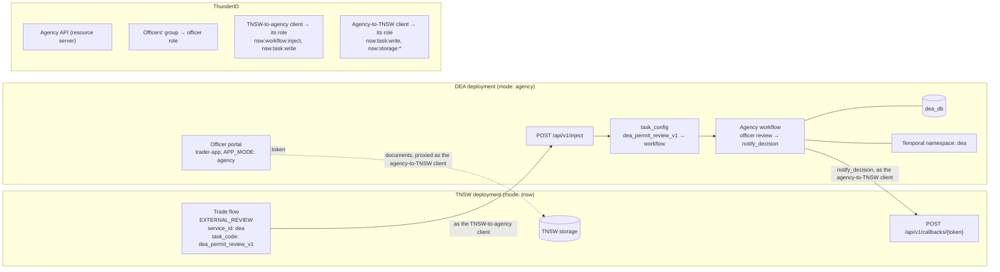

# Onboarding an agency-mode agency

This guide stands up a government agency on the TNSW platform itself: its own deployment
of this backend in `mode: agency`, its own database and Temporal namespace, and an officer
portal (the trader-app in agency mode). CDA runs this way.

TNSW sends such an agency review tasks on `POST /api/v1/inject`, and the agency's workflow
sends the officer's decision back on TNSW's callback route. What agency mode itself does
is in [docs/agency.md](../agency.md).

It takes five places, and the order matters:

1. **The agency's artifacts** in `one-trade-artifacts`: a task config and workflow per
   kind of review.
2. **ThunderID (the IdP)**: the agency's OU, its API, the officer role and group, the
   portal application and the two M2M clients, created in the console; then the
   officers.
3. **Infrastructure**: a database and a Temporal namespace of its own.
4. **The agency deployment**: a second release of the `lk-tnsw` chart.
5. **The TNSW deployment**: where to reach the agency, and the trade-flow step that hands
   work to it.

Every name, URL and handle in this guide is an **example**, for a made-up agency, the
Department of Export Agriculture (DEA). Choose your own to suit your deployment. The guide
refers to each thing by what it is, such as "the officer role", and where a value must be
repeated somewhere else, it says so. [Names used in this guide](#names-used-in-this-guide)
lists them all.

## How the pieces connect



- **The agency's API is a resource server of its own.** Officers' and TNSW's tokens for it
  carry its identifier as `aud`, which the agency checks as `authn.audience`. Its scopes
  keep the `nsw:` names (`nsw:task:write`, `nsw:workflow:inject`, ...) because the backend
  checks those names in both modes.
- **The task code picks the workflow.** TNSW's artifact names a `task_code`; the agency
  looks it up in its manifest as a `task_config`, which names the workflow to start. An
  unknown code is a `400` and records nothing.
- **The task decides who may act.** Every role in the agency's catalog owns every injected
  workflow, so each task names the roles that may open it and run its commands. The
  catalog maps those names to IdP roles, such as `officer` to the officer role.
- **TNSW can reply on a parked step.** Where the artifacts are wired for it, a request for
  more information goes back and forth by reply tokens instead of a new inject, which is
  why the TNSW-to-agency client also needs `nsw:task:write`. See
  [docs/agency.md, Asking for more information](../agency.md#asking-for-more-information).
- **The agency keeps no files.** Its storage proxies TNSW's as the agency-to-TNSW client,
  so officers see the documents traders uploaded.
- **ThunderID generates the IDs, client IDs and secrets.** The configuration examples
  write `<portal client ID>`, `<agency-to-TNSW client ID>` and `<TNSW-to-agency client ID>`
  where a generated client ID goes.

## Before you start

You need:

- A **ThunderID admin** with console access at `https://<idp-host>/console`. The IdP must
  already have the platform resources: the NSW API and a user type for government officers
  (see [idp/README.md, UAT / production](../../idp/README.md#uat--production)).
- **Cluster access** to create a namespace, Secrets and ConfigMaps, and to install a Helm
  release.
- **Postgres admin** access to create a database, and the Temporal CLI pointed at the
  cluster's Temporal frontend.
- **Write access to `one-trade-artifacts`**, and to the TNSW deployment's configuration.
- For **each officer**: username, email, phone (E.164), first and last name.

### Names used in this guide

All examples. Decide yours before starting; the notes say where a value is repeated.

| What                  | Example                                   | Notes                                                                                   |
| --------------------- | ----------------------------------------- | --------------------------------------------------------------------------------------- |
| Agency handle         | `dea`                                     | Short and lowercase. The examples reuse it for the OU, service id, namespace and others |
| Agency name           | `DEA`, `Department of Export Agriculture` |                                                                                         |
| API host              | `https://dea-api.example.com`             | Reachable from the TNSW pods and from officers' browsers                                |
| Portal URL            | `https://dea.example.com`                 |                                                                                         |
| API identifier        | `https://api.dea.nsw-agency.local`        | The token `aud`. Any absolute URI; it is a name, not a URL to reach                     |
| OU                    | `dea`                                     |                                                                                         |
| Agency API            | `DEA API`                                 | The resource server, with the API identifier                                            |
| Officers' group       | `DEA Officers`                            |                                                                                         |
| Officer role          | `DEA Officer`                             | Repeated in the agency's catalog and portal config; must match exactly                  |
| Portal application    | `DEAPortalApp`                            |                                                                                         |
| Agency-to-TNSW client | `DEA_TO_NSW_M2M`, with role `DeaToNswM2M` | The agency calling TNSW                                                                 |
| TNSW-to-agency client | `NSW_TO_DEA_M2M`, with role `NswToDeaM2M` | TNSW calling the agency                                                                 |
| Database              | `dea_db`                                  |                                                                                         |
| Temporal namespace    | `dea`                                     |                                                                                         |
| Artifacts base path   | `dea-v2`                                  | Folder in `one-trade-artifacts`                                                         |
| Kubernetes namespace  | `dea`                                     | With Secret `dea-secrets` and ConfigMap `dea-configs`                                   |

The local agencies (CDA, EFC and others) follow the same pattern, which you can copy, but
nothing depends on it.

## Step 1: Author the agency's artifacts

This is design work rather than operations, so it only outlines what has to exist.
`cda/` in `one-trade-artifacts` is a complete example to copy from.

In the agency's folder (for example `dea-v2/`), for each kind of review:

- A **`task_config`** (`schemaVersion` 2), registered in the folder's manifest with the
  task code as its id, naming the workflow to start:

  ```json
  {
    "schemaVersion": 2,
    "taskCode": "dea_permit_review_v1",
    "workflow": "dea_permit_review_v1",
    "meta": { "title": "Export Permit Review", "description": "…", "category": "DEA" }
  }
  ```

- The **workflow**: the officer's review steps, ending in a `notify_decision` step that
  posts the decision back to TNSW:

  ```json
  {
    "id": "dea-permit-review--notify-decision",
    "task_type": "AUTH_API_CALL",
    "output_namespace": "notifyresult",
    "plugin_properties": {
      "service_id": "tnsw",
      "path": "/api/v1/callbacks/{callbackToken}"
    }
  }
  ```

  The injected payload is the workflow's `notification` variable, and `callbackToken` is
  set from the request. The decision's `command` must be one TNSW's step allows (Step 6).

- On every officer step, the roles that may act: the step's `authz` extension (for example
  `"PENDING_USER": { "submit": ["officer"] }`) and the render config's `read.roles` (for
  example `["officer"]`). A task without them is open to every role in the agency's
  catalog. See [docs/agency.md, Roles per task](../agency.md#roles-per-task).

The TNSW-side step is covered in Step 6. Agree the task codes and commands for both sides
before starting.

## Step 2: Set up the agency in ThunderID

Create the agency's resources in the ThunderID console, in the order below: each one needs
the ones before it. ThunderID generates every ID, client ID and client secret. The names
shown are the examples from [Names used in this guide](#names-used-in-this-guide).

Put every resource in the agency's own OU: where a wizard has an **Organization Unit**
step, choose it.

### 2a. The organization unit

Create an OU for the agency in **Organization Units**, with a handle, name and
description: for example `dea`, `DEA` and `Department of Export Agriculture`.

Where it sits in the tree is the deployment's choice: a root OU (**Add Root Organization
Unit**), or a child of an existing one (open it and use **Add Child OU**). The local setup,
for example, puts every agency under a **Government Organization** OU.

### 2b. The agency's API

In **APIs**, use **Add resource server**:

1. **Type**: **API**.
2. **Details**: a name and the API identifier, for example `DEA API` and
   `https://api.dea.nsw-agency.local`. Leave **Make this the default resource server**
   unchecked.
3. **Permission Delimiter**: **Colon ( : )**. It can't be changed later.
4. **Organization**: the agency's OU.

Then, under **Resources**, add a resource with handle `nsw`, and under it these
sub-resources (**Add sub-resource**) and actions (**Add Action**):

| Sub-resource  | Actions         |
| ------------- | --------------- |
| `consignment` | `read`          |
| `task`        | `read`, `write` |
| `profile`     | `read`          |
| `storage`     | `read`, `write` |
| `workflow`    | `inject`        |

Unlike the names, these handles are fixed: they make the permissions `nsw:task:write`,
`nsw:workflow:inject` and so on, which the backend checks in both modes.

### 2c. The officers' group

In **Groups**, use **Add Group** to create the officers' group in the agency's OU, for
example `DEA Officers`.

### 2d. The officer portal application

In **Applications**, use **Add Application** and create a **Browser App** with **React**
in the agency's OU, for example named `DEAPortalApp`, with **Redirect to ThunderID Gate**
as the sign-in approach. Then, in its tabs:

- **General**: the portal URL under **Authorized redirect URIs**, with **Use the same URLs
  for post-logout redirect**.
- **Access**: under **Allowed User Types**, only the officers' user type
  (`Government_User` in the platform setup). Registration off.
- **Token**, under **Scopes & User Attribute Mappings**: activate `openid`, `profile`,
  `email`, `group`, `role` and `ou`, and add the custom scopes `nsw:consignment:read`,
  `nsw:task:read`, `nsw:task:write`, `nsw:profile:read`, `nsw:storage:read` and
  `nsw:storage:write`. Map `group` to `groups`, `role` to `roles`, and `ou` to `ouId` and
  `ouHandle`.
- **Token**, under **Token Attributes & Response**: add `email`, `phone_number`,
  `given_name`, `family_name`, `username`, `groups`, `roles`, `ouId`, `ouHandle` and
  `ouName` to the access token, and the same except `phone_number` to the ID token.

The portal is a public client with PKCE and no secret. Note its client ID from
**Credentials**: it is the `<portal client ID>` of Step 4.

[`idp/bootstrap/20-agency-cda.yaml`](../../idp/bootstrap/20-agency-cda.yaml) is CDA's
local-dev equivalent, and shows every setting of the three applications.

### 2e. The two M2M applications

Create two more applications in the agency's OU, each a **Backend Service** (client
credentials, client secret sent as HTTP Basic):

| Application           | Example name     | Custom scopes                                                                                                  |
| --------------------- | ---------------- | -------------------------------------------------------------------------------------------------------------- |
| Agency-to-TNSW client | `DEA_TO_NSW_M2M` | `nsw:task:write`, `nsw:consignment:read`, `nsw:storage:read`, `nsw:storage:write`, `nsw:storage:internalwrite` |
| TNSW-to-agency client | `NSW_TO_DEA_M2M` | `nsw:workflow:inject`, `nsw:task:write`                                                                        |

For each, note the client ID from **Credentials**, and copy the client secret straight
into its cluster Secret: the agency-to-TNSW client's into the agency's Secret (Step 4a),
the TNSW-to-agency client's into TNSW's (Step 6a). ThunderID shows a secret only once; if
it is lost, use **Regenerate Client Secret** under **General** → **Danger Zone**.

### 2f. The roles

The scopes an application asks for are granted only through a role. In **Roles**, use
**Add Role** for each of these, in the agency's OU. Choose the permissions in the wizard's
**Permissions** step, then add the assignee on the role's **Assignments** tab (**Add
Assignment**):

| Role                         | Example name  | Permissions                                                                                                                               | Assigned to               |
| ---------------------------- | ------------- | ----------------------------------------------------------------------------------------------------------------------------------------- | ------------------------- |
| Officer role                 | `DEA Officer` | On the agency API: `nsw:consignment:read`, `nsw:profile:read`, `nsw:storage:read`, `nsw:storage:write`, `nsw:task:read`, `nsw:task:write` | The officers' group       |
| TNSW-to-agency client's role | `NswToDeaM2M` | On the agency API: `nsw:workflow:inject`, `nsw:task:write`                                                                                | The TNSW-to-agency client |
| Agency-to-TNSW client's role | `DeaToNswM2M` | On the NSW API: `nsw:consignment:read`, `nsw:storage:read`, `nsw:storage:write`, `nsw:storage:internalwrite`, `nsw:task:write`            | The agency-to-TNSW client |

The officer role's name is repeated in the agency's configuration in Step 4, and must
match there exactly. If the agency's tasks name more roles than `officer`, create one
for each the same way, with its own group.

### 2g. CORS

In **Settings**, add the portal URL to the allowed origins, so the portal can call
ThunderID from the browser.

### 2h. The officers

In **Users**, create each officer in the agency's OU, with the officers' user type. Then
open the officers' group in **Groups** and, under **Members**, use **Add Member** to add
them. The role comes with the group.

## Step 3: Create the database and Temporal namespace

The agency shares the Postgres server and Temporal cluster with TNSW, but nothing else:
its own database, and its own namespace so neither deployment's workers pick up the other's
workflows.

```sh
psql -h <db-host> -U postgres -d postgres -c 'CREATE DATABASE dea_db'
temporal operator namespace create --namespace dea --address <temporal-host>:7233
```

The chart's migration Job creates the tables in Step 4.

## Step 4: Deploy the agency

Install a second release of the `lk-tnsw` chart, in its own namespace. It runs the same
images as TNSW; only the configuration differs.

### 4a. Secrets

```sh
kubectl create namespace dea
read -rs -p 'DB password: ' DB; echo
read -rs -p 'Agency-to-TNSW client secret: ' A2N; echo
KEYSET="$(date +%Y-%m):$(openssl rand -base64 32)"
DB="$DB" A2N="$A2N" KEYSET="$KEYSET" jq -n '{
  apiVersion: "v1", kind: "Secret", metadata: {name: "dea-secrets"},
  stringData: {"db-password": $ENV.DB, "m2m-dea-to-nsw-secret": $ENV.A2N,
               "storage-token-keyset": $ENV.KEYSET}
}' | kubectl apply -n dea -f -
unset DB A2N KEYSET
```

`storage-token-keyset` seals the file tokens officers hold in place of stored file keys.
It is the agency's own, never TNSW's. To rotate it, put a new `kid:key` pair first and
keep the old ones, as for TNSW (see the
[chart README](../../deployments/helm/lk-tnsw/README.md)).

Add the notification provider credentials the same way if the agency's workflows send
email or SMS.

### 4b. The payment methods file

The image ships only templates, so mount the agency's payment methods file at
`/app/configs`. Here and in the Helm values below, the names, hosts and URLs are the
examples; use yours.

The agency's catalog lives in `backend.config.catalog` in the Helm values below. The
agency's outbound `tnsw` service, used by `notify_decision` and storage,
lives in `backend.config.services` in the Helm values below. Its OAuth2 secret is
a `{{env:NAME}}` placeholder expanded while loading the YAML config.

`payment_methods.json`, empty, since an agency takes no payments but the server loads it:

```json
{ "version": "1.0", "methods": [] }
```

```sh
kubectl create configmap dea-configs -n dea \
  --from-file=payment_methods.json
```

### 4c. Values

Start from [`deployments/helm/values-example.yaml`](../../deployments/helm/values-example.yaml)
for the parts not shown (images, routes or ingress, resources). What differs from TNSW, with
[`configs/agency/cda/config.yaml`](../../configs/agency/cda/config.yaml) as the reference:

```yaml
backend:
  env:
    DB_PASSWORD:
      valueFrom: { secretKeyRef: { name: dea-secrets, key: db-password } }
    M2M_DEA_TO_NSW_SECRET:
      valueFrom: { secretKeyRef: { name: dea-secrets, key: m2m-dea-to-nsw-secret } }
    STORAGE_TOKEN_KEYSET:
      valueFrom: { secretKeyRef: { name: dea-secrets, key: storage-token-keyset } }

  volumes:
    - name: agency-configs
      configMap: { name: dea-configs }
  volumeMounts:
    - name: agency-configs
      mountPath: /app/configs
      readOnly: true

  config:
    mode: agency
    server:
      port: 8080
      logLevel: info
      serviceURL: "https://dea-api.example.com"
      maxRequestBytes: 33554432
      readHeaderTimeout: 5s
      readTimeout: 15s
      writeTimeout: 30s
      idleTimeout: 60s
      paymentMethodsConfigPath: configs/payment_methods.json
    # Each role the agency's tasks name, mapped to its IdP role's name exactly as
    # created in Step 2f, and tnsw to the TNSW-to-agency client, whose replies the
    # tasks' waiting steps accept.
    catalog:
      roles:
        officer: DEA Officer
      clients:
        tnsw: NSW_TO_DEA_M2M
    services:
      - id: tnsw
        url: https://nsw-api.example.com
        timeout: 30s
        auth:
          type: oauth2
          oauth2:
            tokenURL: https://idp.example.com/oauth2/token
            clientID: "<agency-to-TNSW client ID>"
            clientSecret: "{{env:M2M_DEA_TO_NSW_SECRET}}"
            scopes: ["nsw:task:write", "nsw:storage:read", "nsw:storage:write", "nsw:storage:internalwrite"]
            endpointParams:
              resource: https://api.nsw-srilanka.local
    db:
      driver: postgres
      postgres:
        host: nsw-db
        port: 5432
        user: postgres
        password: "{{env:DB_PASSWORD}}"
        name: dea_db
        sslMode: require
    cors:
      allowedOrigins: ["https://dea.example.com"]
      allowedMethods: [GET, POST, PUT, DELETE, OPTIONS]
      allowedHeaders: [Content-Type, Authorization]
      allowCredentials: true
      maxAge: 3600
    # Documents live in TNSW; officers reach them through it as the agency-to-TNSW client.
    # Officers' uploads go to TNSW's upload route (nsw:storage:write), so TNSW checks them like
    # a trader's. The files the agency generates itself (a generated document, say) go to its
    # internal upload route (nsw:storage:internalwrite).
    storage:
      type: proxy
      tokenKeyset: "{{env:STORAGE_TOKEN_KEYSET}}"
      tokenTTLSeconds: 3600
      proxy:
        service: tnsw
        uploadPath: /api/v1/storage
        internalUploadPath: /api/v1/internal/storage
        downloadPath: /api/v1/storage/{key}
        deletePath: /api/v1/storage/{key}
        # What officers may upload; anything else is refused before it is sent to TNSW,
        # whose own list decides what it accepts. Compared exactly with the upload's type.
        allowedUploadTypes: [application/pdf, image/jpeg, image/png]
    authn:
      jwksURL: "https://idp.example.com/oauth2/jwks"
      issuer: "https://idp.example.com"
      audience: "https://api.dea.nsw-agency.local"
      insecureSkipTLSVerify: false
    temporal:
      host: temporal
      port: 7233
      namespace: dea
    artifactLoader:
      type: github
      github:
        owner: OpenNSW
        repo: one-trade-artifacts
        ref: <tag or SHA>
        basePath: dea-v2
    notification:
      providers: { … }   # as for TNSW
    # refid: only if the agency's workflows generate reference numbers

migration:
  enabled: true
  env:
    DB_PASSWORD:
      valueFrom: { secretKeyRef: { name: dea-secrets, key: db-password } }
  config:
    db:
      driver: postgres
      postgres: { host: nsw-db, port: 5432, user: postgres, password: "{{env:DB_PASSWORD}}", name: dea_db, sslMode: require }

frontend:
  config:
    APP_MODE: "agency"
    API_BASE_URL: "https://dea-api.example.com"
    APP_URL: "https://dea.example.com"
    IDP_BASE_URL: "https://idp.example.com"
    IDP_CLIENT_ID: "<portal client ID>"
    IDP_EXTRA_QUERY_PARAMS: "resource=https://api.dea.nsw-agency.local"
    IDP_SCOPES: "openid,profile,email,group,role,ou,nsw:consignment:read,nsw:task:read,nsw:task:write,nsw:storage:read,nsw:storage:write,nsw:profile:read"
    SHOW_AUTOFILL_BUTTON: "false"
  branding:
    systemName: "DEA"
    appName: "DEA Officer Portal"
    portalName: "DEA Officer Portal"
    description: "Department of Export Agriculture review of applications received through the National Single Window."
    copyrightNotice: "© 2026 Department of Export Agriculture. All rights reserved."
```

These values must agree, or officers and TNSW get `401`:

| This                                                    | must equal                   |
| ------------------------------------------------------- | ---------------------------- |
| `backend.config.authn.audience`                         | the API identifier (Step 2b) |
| `resource=` in `frontend.config.IDP_EXTRA_QUERY_PARAMS` | the same identifier          |

And this, or officers are signed in but their calls get `403`:

| This                      | must equal                        |
| ------------------------- | --------------------------------- |
| the `catalog.roles` value | the officer role's name (Step 2f) |

### 4d. Install

```sh
helm install dea ./deployments/helm/lk-tnsw -n dea -f dea-values.yaml
kubectl get pods -n dea
```

The migration hook runs first; the backend becomes ready once it reaches the database and the
IdP's JWKS.

## Step 5: Verify the agency on its own

1. An officer signs in at the portal URL. The portal shows an empty case list.
   If the case list fails with `403`, check the officer role's name in the IdP and in
   the catalog.
2. TNSW can get a token for the agency. From a machine that has the TNSW-to-agency
   client's secret, with your client ID, API identifier and IdP host:

   ```sh
   read -rs -p 'TNSW-to-agency client secret: ' SECRET; echo
   curl -s -u "<TNSW-to-agency client ID>:$SECRET" \
     --data-urlencode grant_type=client_credentials \
     --data-urlencode 'scope=nsw:workflow:inject nsw:task:write' \
     --data-urlencode resource=https://api.dea.nsw-agency.local \
     https://idp.example.com/oauth2/token \
     | jq -r .access_token \
     | jq -R 'split(".")[1] | gsub("-";"+") | gsub("_";"/")
              | . + ("=" * ((4 - length % 4) % 4)) | @base64d | fromjson'
   unset SECRET
   ```

   Check `aud` is the API identifier and `scope` has `nsw:workflow:inject` and
   `nsw:task:write`.

Injecting by hand would leave a case no one can finish, so the first real inject comes
from TNSW in Step 6.

## Step 6: Connect TNSW to the agency

TNSW reads all of these at startup, so make the changes together and roll its backend once.

### 6a. The outbound secret

Add the TNSW-to-agency client's secret to TNSW's Secret (`nsw-secrets` in the examples),
and expose it to the backend in TNSW's Helm values, next to the other `M2M_NSW_TO_*`
entries:

```sh
read -rs -p 'TNSW-to-agency client secret: ' S; echo
S="$S" jq -n '{stringData: {"m2m-nsw-to-dea-secret": $ENV.S}}' \
  | kubectl patch secret nsw-secrets -n tnsw --type merge --patch-file /dev/stdin
unset S
```

```yaml
backend:
  env:
    M2M_NSW_TO_DEA_SECRET:
      valueFrom: { secretKeyRef: { name: nsw-secrets, key: m2m-nsw-to-dea-secret } }
```

### 6b. TNSW's configuration

In TNSW's `config.yaml` (or `backend.config` in Helm values), add the agency to
`services`, with the handle as its `id`, like the `cda` entry in
[`configs/config.example.yaml`](../../configs/config.example.yaml):

```yaml
services:
  - id: dea
    url: https://dea-api.example.com
    timeout: 30s
    auth:
      type: oauth2
      oauth2:
        tokenURL: https://idp.example.com/oauth2/token
        clientID: "<TNSW-to-agency client ID>"
        clientSecret: "{{env:M2M_NSW_TO_DEA_SECRET}}"
        scopes: ["nsw:workflow:inject", "nsw:task:write"]
        endpointParams:
          resource: https://api.dea.nsw-agency.local
```

In TNSW's catalog, in the same file, map the handle to the agency-to-TNSW client under
`clients`, so that artifacts naming the handle match its callbacks:

```yaml
catalog:
  clients:
    dea: "<agency-to-TNSW client ID>"
```

Then roll out:

```sh
helm upgrade lk-tnsw ./deployments/helm/lk-tnsw -n tnsw -f <your-values>.yaml
```

If `config.yaml` comes from a ConfigMap outside the chart, update it
first, then `kubectl rollout restart deployment/<backend> -n tnsw`.

### 6c. The trade-flow step

In `one-trade-artifacts`, under `tnsw/`, the step that hands work to the agency is an
`EXTERNAL_REVIEW` task:

```json
{
  "id": "dea-export-permit--external-review",
  "task_type": "EXTERNAL_REVIEW",
  "output_namespace": "reviewerform",
  "plugin_properties": {
    "service_id": "dea",
    "path": "/api/v1/inject",
    "task_code": "dea_permit_review_v1"
  },
  "extensions": [
    {
      "id": "authz",
      "phase": "PRE_RESUME",
      "properties": {
        "QUEUED_EXTERNALLY": { "approve": ["dea"], "reject": ["dea"] }
      }
    }
  ]
}
```

- `service_id` is the `config.yaml` services `id`, and `task_code` the agency's manifest id from
  Step 1.
- The `authz` extension lists, per command, the catalog names allowed to send it: the
  commands the agency's `notify_decision` sends. Without it, any client TNSW accepts could
  decide this step.

Merge the change and move TNSW's artifact `ref` to it. Then run a real consignment
through: the officer sees the case, decides, and the trader's consignment moves on.

## Common changes

| Task                                      | Where                                                                                                                      |
| ----------------------------------------- | -------------------------------------------------------------------------------------------------------------------------- |
| Add an officer                            | Step 2h only                                                                                                               |
| Add a role                                | A role and group in ThunderID (Step 2f), the agency's catalog, and the tasks' `authz` and `read.roles` (Step 1)            |
| Add a kind of review                      | A task config and workflow (Step 1), the TNSW step (Step 6c), then move both deployments' artifact `ref`                   |
| Add a portal URL                          | Add it to the portal application's redirect URIs in the console, to the agency's `cors`, and to ThunderID's CORS (Step 2g) |
| Change the officer role's name            | The IdP role and the agency's catalog together                                                                             |
| Rotate the agency-to-TNSW client's secret | **Regenerate Client Secret** in the console (Step 2e), update the agency's Secret, then restart the agency backend         |
| Rotate the TNSW-to-agency client's secret | **Regenerate Client Secret** in the console (Step 2e), update TNSW's Secret, then restart the TNSW backend                 |
| Upgrade                                   | `helm upgrade <release> …` with the same chart version as TNSW. Migrations are shared, so keep the two on the same release |

## Troubleshooting

| Symptom                                                 | Likely cause                                                                                                                                                                                                                                 |
| ------------------------------------------------------- | -------------------------------------------------------------------------------------------------------------------------------------------------------------------------------------------------------------------------------------------- |
| An M2M token request fails with `invalid_scope`         | The application lacks the scope (Step 2e), or no role grants it the permission (Step 2f)                                                                                                                                                     |
| Backend exits at startup naming `mode` or `tokenKeyset` | `mode` missing or misspelled (it must be `agency`), or `STORAGE_TOKEN_KEYSET` unset                                                                                                                                                          |
| Backend logs Temporal errors about the namespace        | The Temporal namespace not created (Step 3), or `temporal.namespace` differs                                                                                                                                                                 |
| Officer signs in, but every call is `401`               | `authn.audience` ≠ the `resource=` the portal sends                                                                                                                                                                                          |
| Officer gets `403` opening a task                       | The task's `read.roles` or `authz` doesn't name a catalog role the officer holds, the catalog's name doesn't match the token's `roles`, or the officer isn't in the group                                                                    |
| Inject `401`                                            | TNSW's service entry in `config.yaml` asks for a `resource` other than the agency's `authn.audience`                                                                                                                                         |
| Reply `403` `client … is not permitted`                 | The agency's catalog doesn't map `tnsw` under `clients` to the TNSW-to-agency client (Step 4c)                                                                                                                                               |
| Inject or reply `403` `insufficient scope`              | The TNSW-to-agency client lacks its role (Step 2f), or the `config.yaml` services entry doesn't request `nsw:workflow:inject` and `nsw:task:write`                                                                                           |
| Inject `400` `unknown task code`                        | The code isn't registered in the agency folder's manifest, or the agency loads another `ref`                                                                                                                                                 |
| Inject `409`                                            | The same `taskId` was injected before with a different `consignmentId` or `taskCode`                                                                                                                                                         |
| Officer can't open or upload documents                  | The agency-to-TNSW client lacks its role (Step 2f), or `M2M_DEA_TO_NSW_SECRET` is wrong                                                                                                                                                      |
| Officer decides, but TNSW's consignment doesn't move    | The `notify_decision` call failed; see the agency backend's logs. A callback `401` means the token's `aud` isn't TNSW's `authn.audience`; a `403`, that it lacks `nsw:task:write` or isn't the agency's client in TNSW's catalog (6b)        |

## Local development

CDA, EFC, FCAU, NPQS and SLTB run this way under Docker Compose.
[`configs/agency/cda/README.md`](../../configs/agency/cda/README.md) covers starting one,
and is the model for a new agency: copy `configs/agency/cda/` for the new handle. Locally,
the IdP resources come from a bootstrap document with fixed IDs and client IDs instead of
the console: copy [`idp/bootstrap/20-agency-cda.yaml`](../../idp/bootstrap/20-agency-cda.yaml)
as described in [idp/README.md, Changing resources](../../idp/README.md#changing-resources).
