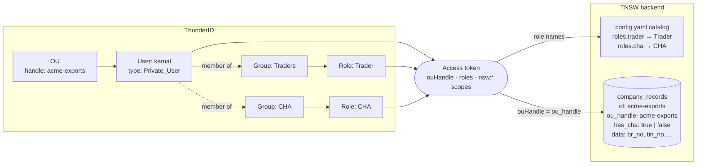

# Onboarding a trader or CHA company

This guide adds a new private-sector company to a running TNSW deployment and gives its
staff access to the trader portal as **traders**, **CHAs** (Customs House Agents), or both.

It takes two systems, and the order matters:

1. **ThunderID (the IdP)**: the company's organisation unit (OU), its users, and their
   group memberships.
2. **The TNSW database**: the company record, written with the `otc` CLI from inside the
   backend pod.

For the local docker-compose setup, see [Local development](#local-development) at the end.

## How the pieces connect



- **Company membership comes from the OU.** Every portal token carries an `ouHandle` claim,
  the handle of the OU the user sits in. The backend looks up the company whose `ou_handle`
  equals it (`internal/tasks/authzgate`, `internal/profile/handler.go`). If no company has
  that handle, the user can sign in but owns nothing.
- **What a user may do comes from the groups.** `Traders` grants the `Trader` role and
  `CHA` grants the `CHA` role (`idp/bootstrap/10-nsw-platform.yaml`). Both carry
  the `traderNsw` scope set. The `catalog` section of `config.yaml` maps the role names
  the backend expects (`trader`, `cha`) to these IdP role names.
- **Whether traders can pick a company as their CHA comes from `has_cha`.** The CHA picker
  in the trader portal lists companies with `has_cha = true`, and the `cha_persist` plugin
  refuses to assign a company without it.

A consignment belongs to the trader's company, plus the CHA company the trader picks.
A user acts as trader on consignments their company owns, and as CHA on consignments that
name their company as CHA.

## Before you start

You need:

- A **ThunderID admin**: console access at `https://<idp-host>/console`, or a management
  token (see [idp/README.md, UAT / production](../../idp/README.md#uat--production)).
- **`kubectl` access** to the TNSW namespace, with permission to `exec` into the backend pod.
- The **company details**:

  | Field                                  | Example                  | Notes                                                       |
  | -------------------------------------- | ------------------------ | ----------------------------------------------------------- |
  | Company ID                             | `acme-exports`           | Lowercase, hyphenated, permanent. Used as the OU handle too |
  | Legal name                             | `ACME EXPORTS (PVT) LTD` |                                                             |
  | Acts as CHA?                           | yes / no                 | Becomes `hasCha`                                            |
  | Address, BR no., VAT no., TIN          | `PV-00123456`, ...       | Stored in `data`; read by workflows and forms               |
  | SLPA CMS client key                    | `agztNvLSUA`             | Only if registered with SLPA; else omit                     |
  | Agency registration numbers (e.g. CDA) | `CDA-EXP-000123`         | Only for agencies the company is registered with            |

- For **each user**: username, email, phone (E.164, e.g. `+94771234567`), first and last
  name, and whether they are a trader, a CHA, or both.

Use the company ID as the OU handle. The two can differ, but keeping them equal removes a
whole class of mismatch.

## Step 1: Create the company's OU in ThunderID

Create a child OU under **Private Sector** (handle `private-sector`).

**Console:** Organization Units → `Private Sector` → add a child OU.

| Field       | Value                    |
| ----------- | ------------------------ |
| Handle      | `acme-exports`           |
| Name        | `ACME EXPORTS (PVT) LTD` |
| Description | free text                |

**API.** Read the management token with a silent prompt so it stays out of shell history,
and send it from a file descriptor so it never appears in `curl`'s arguments, which other
users can see in the process list:

```sh
IDP=https://idp.example.com
read -rs -p 'Management token: ' TOKEN; echo

# curl with the auth header read from a file descriptor; request bodies go on stdin (-d @-).
idp() {
  curl -s -H @<(printf 'Authorization: Bearer %s\n' "$TOKEN") \
    -H 'Content-Type: application/json' "$@"
}

PRIVATE_SECTOR_ID=$(idp "$IDP/organization-units/tree/private-sector" | jq -r .id)

jq -n --arg parent "$PRIVATE_SECTOR_ID" '{
  handle: "acme-exports",
  name: "ACME EXPORTS (PVT) LTD",
  description: "ACME EXPORTS (PVT) LTD",
  parent: $parent
}' | idp -X POST "$IDP/organization-units" -d @- | jq .

OU_ID=$(idp "$IDP/organization-units/tree/private-sector/acme-exports" | jq -r .id)
```

Run the later API steps in the same shell, and `unset TOKEN` when you are done.

The **handle** is what ends up in the token. Write it down exactly; Step 4 needs it.

## Step 2: Create the users

Create each user in the new OU with user type **`Private_User`**. That type requires
`username`, `password` and `email`, all unique, and accepts `phone_number`,
`given_name` and `family_name`.

**Console:** Users → add user → type `Private_User`, OU `ACME EXPORTS (PVT) LTD`.

**API:**

The initial password is prompted for too, and reaches `jq` through its environment
(`$ENV`) rather than its arguments:

```sh
read -rs -p 'Initial password for kamal: ' INITIAL_PASSWORD; echo

INITIAL_PASSWORD="$INITIAL_PASSWORD" jq -n --arg ou "$OU_ID" '{
  type: "Private_User",
  ouId: $ou,
  attributes: {
    username: "kamal",
    password: $ENV.INITIAL_PASSWORD,
    email: "kamal@acme-exports.lk",
    given_name: "Kamal",
    family_name: "Perera",
    phone_number: "+94771234567"
  }
}' | idp -X POST "$IDP/users" -d @- | jq .
unset INITIAL_PASSWORD

USER_ID=$(idp "$IDP/users?limit=100&offset=0" \
  | jq -r '.users[] | select(.attributes.username == "kamal") | .id')
```

Hand the initial password over out of band and have the user change it.

## Step 3: Add the users to `Traders` and/or `CHA`

Roles are inherited through groups. Never assign `Trader` or `CHA` to a user directly.

| The user should...                          | Add to              |
| ------------------------------------------- | ------------------- |
| raise and manage the company's consignments | `Traders`           |
| act as CHA on other traders' consignments   | `CHA`               |
| do both                                     | `Traders` and `CHA` |

Adding a user to `CHA` only makes sense if the company will have `hasCha: true` in Step 4.

**Console:** Groups → `Traders` (or `CHA`) in the `Private Sector` OU → add members.

**API:**

```sh
GROUP_ID=$(idp "$IDP/groups?limit=100&offset=0" \
  | jq -r --arg ou "$PRIVATE_SECTOR_ID" '.groups[] | select(.name == "Traders" and .ouId == $ou) | .id')

jq -n --arg id "$USER_ID" '{members: [{id: $id, type: "user"}]}' \
  | idp -X POST "$IDP/groups/$GROUP_ID/members/add" -d @- | jq .
```

Repeat with `CHA` as needed.

## Step 4: Register the company with `otc`, inside the backend pod

The backend image ships the `otc` CLI at `/usr/local/bin/otc`. In the pod it reads the same
`config.yaml` as the server (`CONFIG_PATH` is already set to `/app/config/config.yaml`),
so it connects to the right database with no extra setup.

Find the backend pod:

```sh
NS=tnsw
kubectl get pods -n "$NS" -l app.kubernetes.io/component=backend
POD=$(kubectl get pods -n "$NS" -l app.kubernetes.io/component=backend \
  -o jsonpath='{.items[0].metadata.name}')
```

### Option A: declarative apply (recommended)

Write the company to a file. The shape is the one in
[`configs/companies.example.json`](../../configs/companies.example.json):

```json
{
  "companies": [
    {
      "id": "acme-exports",
      "name": "ACME EXPORTS (PVT) LTD",
      "ouHandle": "acme-exports",
      "hasCha": true,
      "data": {
        "address": "No. 12, Main Street, Colombo 01, Sri Lanka",
        "br_no": "PV-00123456",
        "vat_no": "VAT-409123456-7000",
        "tin_no": "134256789",
        "slpacmsuser_key": "<key issued by SLPA>",
        "agencies": {
          "cda": { "registration_number": "CDA-EXP-000123" }
        }
      }
    }
  ]
}
```

Stream it into the pod over stdin, so nothing has to be written to the container's
filesystem:

```sh
kubectl exec -i -n "$NS" "$POD" -- otc company apply -f /dev/stdin < acme-exports.json
```

```text
[1/1] OK "acme-exports"

Applied 1/1 company definitions (0 failed).
```

`apply` is an upsert keyed on `id`: re-running it updates `name`, `ouHandle`, `hasCha` and
**replaces `data` as a whole**. Always apply the complete record, not just the fields you
are changing. That makes the file a good source of truth to keep, wherever your team keeps
deployment config.

### Option B: interactive wizard

```sh
kubectl exec -it -n "$NS" "$POD" -- otc company add
```

It prompts for the ID, name, OU handle (defaulting to the ID) and CHA capability, then
offers to open an editor for `data`. Set `EDITOR=vi` if it can't find one:

```sh
kubectl exec -it -n "$NS" "$POD" -- env EDITOR=vi otc company add
```

### Check the record

```sh
kubectl exec -n "$NS" "$POD" -- otc company list
kubectl exec -n "$NS" "$POD" -- otc company view acme-exports
```

Confirm that `OU Handle` matches the handle from Step 1 character for character.

## Step 5: Verify end to end

1. The user signs in to the trader portal. The profile shows **ACME EXPORTS (PVT) LTD**.
   If no company shows, the `ouHandle` in the token and the record's `ou_handle` differ.
2. A **trader** can create a consignment.
3. If `hasCha` is true, a trader from **another** company sees ACME in the CHA picker,
   and a CHA user from ACME sees consignments assigned to ACME once one is.
4. A user in both groups sees, in one list, the consignments ACME is the trader on and
   those it is the CHA on.

To see what the backend gets, decode the user's access token (browser dev tools, or any
JWT decoder you trust) and check `ouHandle`, `roles` and `aud`
(`https://api.nsw-srilanka.local`).

## Common changes

| Task                                    | Where                                                                                                                    |
| --------------------------------------- | ------------------------------------------------------------------------------------------------------------------------ |
| Add another user to an existing company | Steps 2 and 3 only, in the company's existing OU                                                                         |
| Make a trader company a CHA too         | Set `hasCha: true` and re-apply (Step 4), then add the CHA users to `CHA` (Step 3)                                       |
| Update BR / VAT / TIN / SLPA key        | Edit the file and re-apply, or `otc company edit <id>` (interactive; needs `-it`)                                        |
| Remove a user's access                  | Disable or delete the user in ThunderID, or remove them from the groups. Nothing to change in TNSW                       |
| Rename an OU handle                     | Avoid. If it can't be helped, change it in ThunderID and update `ouHandle` in TNSW together, since `ou_handle` is unique |

There is no `otc company delete`. Offboard a company by removing its users' access in
ThunderID.

## Troubleshooting

| Symptom                                                   | Likely cause                                                                                                                          |
| --------------------------------------------------------- | ------------------------------------------------------------------------------------------------------------------------------------- |
| User signs in, but no company on the profile              | No `company_records` row with this `ou_handle`. Check `otc company view` against the token's `ouHandle`                               |
| `403` on consignments or tasks                            | User not in `Traders` / `CHA`, or `catalog.roles` in `config.yaml` doesn't match the IdP role names                                   |
| Token has no `nsw:*` scopes / `invalid_target` at sign-in | The portal isn't sending `resource=https://api.nsw-srilanka.local`; see [idp/README.md](../../idp/README.md#api-authorization-oauth2) |
| Company missing from the CHA picker                       | `hasCha` is `false`                                                                                                                   |
| `cha_persist: company "…" is not enabled as a CHA`        | Same: a trader picked a company whose `hasCha` was turned off since                                                                   |
| `ou_handle "…" is already used by another company`        | Two records claim the same OU. Each OU maps to exactly one company                                                                    |
| `otc`: `Failed to load configuration`                     | Running outside the pod without `CONFIG_PATH`, or a `{{env:…}}` placeholder in `config.yaml` is unset                                 |
| User created but can't sign in to the trader portal       | Wrong user type. `TraderApp` only admits `Private_User`                                                                               |

## Local development

The same model, but driven from files in the repo:

1. In [`idp/bootstrap/90-sample-data.yaml`](../../idp/bootstrap/90-sample-data.yaml), add
   the OU and the users, and list the users under the `Traders` / `CHA` group documents,
   following the `adam-pvt-ltd` entries. Give each new document its own `id`.
2. Restart the stack with `docker compose up`. `thunderid-setup` re-imports the
   bootstrap documents as an upsert, so additions apply on restart
   (see [idp/README.md, Changing resources](../../idp/README.md#changing-resources)).

3. Add the company to your local `configs/companies.json` (copied from
   `companies.example.json`) and apply it. The compose `seed-companies` service does this
   on `docker compose up`. To re-apply after editing the file:

   ```sh
   docker compose run --rm seed-companies
   ```

   For a native run, use `go run ./cmd/otc company apply -f configs/companies.json` from the repo root.

`90-sample-data.yaml` holds sample data only. Don't add real companies or users to it.
